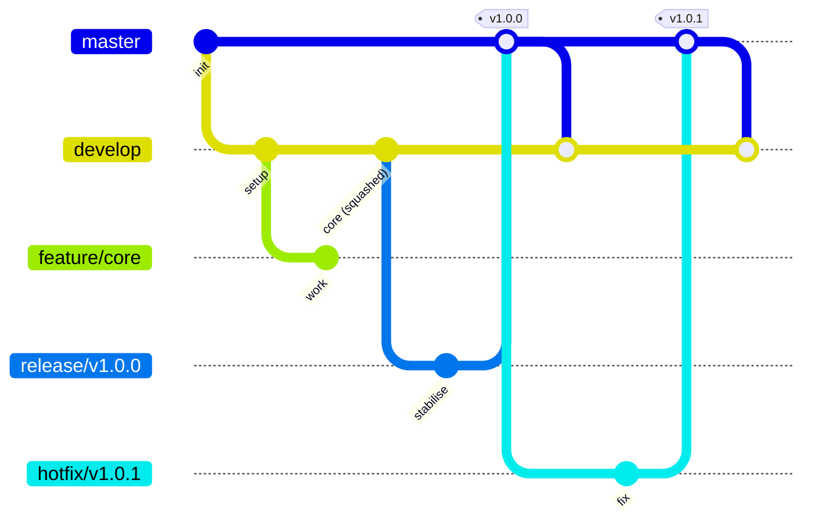

# CONTRIBUTING

This guide explains how to contribute to the repository, covering branching, CI, and the coding standards and best
practices followed across NinjaMonkeyGames projects. Consistent, high-quality code matters just as much as a smooth
development process. Questions? Contact the repository owner using the details in the footer.

---
<!-- markdownlint-disable MD013 -->
## TABLE OF CONTENTS

- [CONTRIBUTING](#contributing)
  - [TABLE OF CONTENTS](#table-of-contents)
  - [GitHub Workflow](#github-workflow)
    - [Branching Workflow](#branching-workflow)
      - [Permanent branches](#permanent-branches)
      - [Supporting branches](#supporting-branches)
      - [Naming conventions](#naming-conventions)
      - [Workflow](#workflow)
        - [Starting a feature](#starting-a-feature)
        - [Starting a release](#starting-a-release)
        - [Starting a hotfix](#starting-a-hotfix)
      - [Pull requests](#pull-requests)
      - [Closing issues](#closing-issues)
    - [Commit message requirements](#commit-message-requirements)
    - [Continuous integration checks](#continuous-integration-checks)
    - [Version control \& the `.yyp` file](#version-control--the-yyp-file)
    - [Code comment style](#code-comment-style)
    - [Spelling exceptions (cspell)](#spelling-exceptions-cspell)
    - [Principles](#principles)
      - [1. The principle of Model-View-Controller (MVC) separation](#1-the-principle-of-model-view-controller-mvc-separation)
  - [CONTACT INFORMATION](#contact-information)
  - [COPYRIGHT](#copyright)
<!-- markdownlint-enable MD013 -->
---

## GitHub Workflow

Everything about how this repository uses git and GitHub: branching, commits, pull requests, CI, and the
repo's own Markdown/config conventions.

### Branching Workflow

This repository follows a Gitflow-style workflow, with one deliberate deviation from strict Gitflow: **feature branches
are squash-merged into `develop`**, rather than merged with a merge commit. Release and hotfix branches still merge
normally (a real merge commit), so `master`'s history and version tags stay intact.

It defines two permanent branches and several types of short-lived supporting branches, each with a specific purpose and
merge direction.

---

#### Permanent branches

| Branch    | Purpose                                                                                     |
| --------- | ------------------------------------------------------------------------------------------- |
| `master`  | Production-ready code only. Every commit on `master` is a release.                          |
| `develop` | Integration branch. Reflects the latest delivered development changes for the next release. |

Nobody commits directly to `master` or `develop`. All changes arrive via pull requests from supporting branches.

---

#### Supporting branches

| Branch  | From      | Merges into | Merge type   | Naming              | Purpose                          |
| ------- | --------- | ----------- | ------------ | ------------------- | -------------------------------- |
| Feature | `develop` | `develop`   | Squash merge | `feature/<name>`    | New or in-progress functionality |
| Release | `develop` | `master`    | Merge commit | `release/<version>` | Stabilise and prepare a release  |
| Hotfix  | `master`  | `master`    | Merge commit | `hotfix/<version>`  | Urgent production fixes          |

Squashing a feature branch collapses all of its commits into a single new commit on `develop`. That commit has no
merge-parent link back to `feature/<name>`, so the branch's individual commits do not appear in `develop`'s history —
only the squashed result does.

**Neither `release/*` nor `hotfix/*` ever merges into `develop` directly.** Both only ever merge _out_ to `master` via
pull request. `develop` picks up everything that lands on `master` — a release, a hotfix, or semantic-release's own
version-bump commit — exclusively through the automated sync pull request that `sync-master-to-develop.yaml` opens from
`master` into `develop` (see [Starting a release](#starting-a-release) / [Starting a hotfix](#starting-a-hotfix)).
Allowing a second, direct `release/*`/`hotfix/*` → `develop` path alongside that sync PR would risk the same commits
landing in `develop`'s history twice, so `check-source-branch` rejects any pull request that targets `release/*` or
`hotfix/*`, or that targets `develop` from anything other than `feature/*` or the sync PR's `master` head.



---

#### Naming conventions

- Feature branches: `feature/<short-description>` (e.g. `feature/login-page`)
- Release branches: `release/<version>` (e.g. `release/v1.1.0`)
- Hotfix branches: `hotfix/<version>` (e.g. `hotfix/v1.0.1`)

Versions follow [Semantic Versioning](https://semver.org/) (`vMAJOR.MINOR.PATCH`).

---

#### Workflow

##### Starting a feature

```text
git checkout develop
git pull origin develop
git checkout -b feature/<short-description>
```

Push the branch and open a pull request into `develop` when ready. **Squash merge** the pull request — GitHub's "Squash
and merge" option, or the CLI equivalent — so the feature lands on `develop` as one commit. Delete the feature branch
once merged.

##### Starting a release

When `develop` has enough features for a release:

```text
git checkout develop
git pull origin develop
git checkout -b release/<version>
```

Only bug fixes, documentation, and release-related chores (version bumps, changelog) belong on a release branch — no new
features.

While a release branch is open, any change that later lands on `master` (a hotfix, semantic-release's own version-bump
commit, anything) is merged into it automatically by `sync-master-to-develop.yaml` — see
[Starting a hotfix](#starting-a-hotfix) for how.

When the release branch is stable:

1. Open a pull request from `release/<version>` into `master`. Merging tags the resulting commit as `<version>`.
2. `sync-master-to-develop.yaml` automatically **opens** a pull request bringing that merge (and anything else new on
   `master`, including semantic-release's own version-bump commit) into `develop` as a regular merge commit, not squash.
   It does **not** merge that PR — a human still reviews and merges it, same as every other pull request in this repo.
   Merge it once it's ready so the fixes made during stabilisation aren't left behind.
3. Delete the release branch.

##### Starting a hotfix

For an urgent fix to production:

```text
git checkout master
git pull origin master
git checkout -b hotfix/<version>
```

When the fix is ready:

1. Open a pull request from `hotfix/<version>` into `master`. Merging tags the resulting commit as `<version>`.
2. `sync-master-to-develop.yaml` automatically **opens** a pull request bringing that merge into `develop` as a regular
   merge commit, not squash. It does **not** merge that PR — a human still reviews and merges it. Do this promptly so
   the fix is included in future releases.
3. The same workflow also **merges `master` directly into every currently open `release/*` branch**, with no pull
   request and no review gate before the merge lands — `release/*` branches can't receive an incoming PR at all (see
   [Pull requests](#pull-requests)), so a direct push, done automatically, is what closes the "an in-flight release
   can't ship without this fix either" gap. If `master` and a release branch have diverged in a way Git can't merge
   automatically, that branch is skipped and the workflow run fails loudly rather than silently — resolve it the same
   way you would by hand: check out the release branch, merge or rebase `master`'s changes onto it, resolve the
   conflict, and push directly.
4. Delete the hotfix branch.

---

#### Pull requests

- All merges into `master` or `develop` happen via pull request — no direct pushes.
- A pull request into `master` must come from a `release/*` or `hotfix/*` branch. Enforced by the `Branch Policy Check`
  required status check — see [Continuous integration checks](#continuous-integration-checks).
- `feature/*` → `develop` pull requests must be **squash merged**.
- `release/*` and `hotfix/*` pull requests must use a regular **merge commit** (not squash, not rebase) — this keeps
  `master`'s history and tags accurate. The same applies to the automated `master` → `develop` sync pull request, so the
  stabilisation commits it carries aren't collapsed away.
- Pull requests **into** `release/*` or `hotfix/*` are rejected outright by `check-source-branch` — these branches only
  ever merge _out_ (to `master`). Push fixes to them directly instead; see [Starting a release](#starting-a-release) /
  [Starting a hotfix](#starting-a-hotfix). This is also why keeping an open `release/*` branch in sync with `master` is
  a direct push rather than a pull request — see [Starting a hotfix](#starting-a-hotfix).
- Force-pushing is blocked on every branch **except** `feature/*` and `hotfix/*`, which stay open for rebasing or
  amending your own in-progress work.
- Keep feature branches short-lived and up to date with `develop` to avoid large, conflict-prone merges.

---

#### Closing issues

⚠️ Closing issues automatically happens when merge with develop branch is complete.
`.github/workflows/close-referenced-issues.yaml`.

---

### Commit message requirements

All commit messages, and `feature/*` → `develop` pull request titles and descriptions (squashing turns the PR title +
body into the actual commit message — see [Supporting branches](#supporting-branches)), must follow
[Conventional Commits](https://www.conventionalcommits.org/) as configured in `.config/commitlint.config.mjs`, with
custom plugins at `.config/signed-off-by-regex.js` and `.config/issue-reference-keyword.js`. Pull request titles and
descriptions are actually checked against `.config/commitlint.pr-message.config.mjs`, a thin wrapper around the same
config — see the note on `Signed-off-by` below for the one rule it changes.

Beyond the standard Conventional Commits format, this project requires:

- A **scope** from a fixed list: `core`, `api`, `ui`, `auth`, `db`, `deps`, `tests`, `config`, `security`, `rebase`.
- A **body** of at least 10 characters, in sentence case.
- A **`Signed-off-by: Name <email@example.com>`** line — a
  [Developer Certificate of Origin](https://developercertificate.org/)-style sign-off, not a cryptographically signed
  commit.
- At least one **issue reference**, on its own line starting with exactly `Close`, `Fix`, or `Reference` — see
  [Closing issues](#closing-issues) for the full explanation of why only these three, and why case and inflection
  matter.

ℹ️ **Imperative mood is encouraged, not enforced.** Aim for subjects like "add X" / "fix Y" rather than "added X" /
"fixed Y" — read it as completing "This commit will ...". `.config/commitlint.config.mjs` has no rule checking this, and
isn't expected to gain one: reliably telling imperative from past-tense/gerund phrasing from a short subject line runs
into real ambiguity (irregular verbs, ordinary words that merely look like the wrong tense), so a linter here would end
up rejecting valid subjects about as often as it let bad ones through. Treat it as a style worth reaching for, not a
check you need to pass.

🔒 **Separately enforced by branch protection, not commitlint:** every commit, on every branch, must be
**cryptographically signed** (GPG or SSH) — this is a repository rule, checked at push time, not a commitlint rule. It's
a different requirement from the `Signed-off-by` line above: that's a DCO-style text trailer commitlint checks the
content of; this is a real cryptographic signature Git itself verifies. Configure commit signing locally (see
[GitHub's guide](https://docs.github.com/en/authentication/managing-commit-signature-verification)) or pushes will be
rejected outright, regardless of message content.

ℹ️ **Don't retype `Signed-off-by` into a `feature/*` → `develop` pull request description.** If your branch's commit
already carries a valid `Signed-off-by` trailer, GitHub auto-fills the PR description from that commit but strips the
trailer out of the auto-filled text — not because it's missing, but because GitHub recognises it as a git trailer and
re-attaches it to the final squash commit automatically from the source commit(s), regardless of what the description
says. Typing it into the description anyway doesn't add coverage (the commit already has it, and `preview / commitlint`
already lints that commit in full on every push); it only creates a second copy, which then shows up duplicated in the
"Squash and merge" button's editable commit message. This is why `.config/commitlint.pr-message.config.mjs` — used to
lint the PR title and description, see [Continuous integration checks](#continuous-integration-checks) — disables the
`signed-off-by` and `signed-off-by-regex` rules for that check specifically; every other rule in it is unchanged.

Example:

```text
feat(core): add player movement

Adds basic WASD movement to the player controller.

Reference #123

Signed-off-by: Jane Doe <jane@example.com>
```

---

### Continuous integration checks

Pushing to any branch, and opening a pull request into `develop` or `master`, trigger automated checks:

| Check                      | Runs on                          | What it checks                                       |
| -------------------------- | -------------------------------- | ---------------------------------------------------- |
| `preview / commitlint`     | Every push*                      | Latest commit (or range); see [requirements][cm]     |
| `preview / markdownlint`   | Every push*                      | Every Markdown file in the repo, `.config/` included |
| `preview / cspell`         | Every push*                      | Spelling across the repo, plus dotfiles (`--dot`)    |
| `preview / shellcheck`     | Every push*                      | Every `*.sh` file via `find`, `.config/` included    |
| `preview / eslint`         | Every push*                      | JS/TS and JSON/JSONC, `.config/eslint.config.js`     |
| `lint-pr-message`          | feature/* → develop PRs          | Title/body, plus every commit's Signed-off-by        |
| `check-source-branch`      | PRs into 4 branches†             | Source branch is on the allow-list                   |
| `release`                  | Push to master/develop/release/* | Runs semantic-release when warranted                 |
| `sync`                     | Push to master                   | Opens develop sync PR; merges master into release/*  |

[cm]: #commit-message-requirements

\* Push to `feature/*`, `develop`, `release/*`, `hotfix/*`, or `master`.

† `master`, `develop`, `release/*`, or `hotfix/*`.

All seven `preview / *` checks also register a `preview` GitHub Deployment for the commit.

---

### Version control & the `.yyp` file

- Treat `.yyp`/`.yy` files as build output, not hand-edited prose: let the IDE make the change, don't hand-edit the
  JSON, and don't try to manually resolve a `.yyp` merge conflict by eyeballing it — GameMaker's own Source Control
  conflict tools (or a dedicated external merge tool) understand the file's structure in a way a plain text diff
  doesn't.
- Avoid two people adding, renaming, or reordering top-level assets (objects, rooms, scripts) at the same time — the
  `.yyp`'s own resource-order list is a single shared array, and simultaneous changes to it are one of the more
  common sources of GameMaker merge conflicts. Say so in the team channel before a large asset restructure.

---

### Code comment style

In source-code comments (`.mjs`, `.js`, `.sh`, `.yaml`, etc.), prefer backticks (`` ` ``) over single quotes (`'`) when
quoting an identifier, value, file path, or branch name — e.g. `` `feature/*` `` rather than `'feature/*'`. This matches
how this document quotes identifiers and keeps quoting consistent between prose and code.

---

### Spelling exceptions (cspell)

When `preview / cspell` flags a real word that isn't a typo (a name, a technical term, an abbreviation), scope the
fix to the file it actually occurs in — don't add it to `.config/cspell.json`'s top-level `words` list. That list
applies repository-wide, forever, so every addition there quietly disables the check for that word everywhere in the
repo, not just where it's actually used.

- **One-off, in a single file:** add an inline directive as a comment in that file, using whatever comment syntax the
  file itself uses — e.g. `# cspell:ignore someword` in a `.sh`/`.yaml` file, `// cspell:ignore someword` in `.js`,
  or `<!-- cspell:ignore someword -->` in Markdown. Use `cspell:words` instead of `cspell:ignore` if the word should
  actually be recognized (and offered as a suggestion) rather than merely skipped. Either way, the exception applies
  to that one file only.
- **Recurring across a whole file type:** add a scoped entry to `.config/cspell.json`'s `overrides` array instead,
  keyed to a glob — see the existing `**/*.yyp, **/*.yy` entry there for the pattern to follow. This widens the
  exception to every file matching that glob, and no further.
- **Reserve the top-level `words` list** for words that are genuinely project-wide vocabulary — the org/product
  name, a term that recurs across most of the repo — not for something that happens to show up in one place.

---

### Principles

#### 1. The principle of Model-View-Controller (MVC) separation

---

## CONTACT INFORMATION

Author: Daniel Mallett (Monkey Knuckles)

If you have any problems with the repository or have any suggestions please contact us at <info@ninjamonkeygames.com>.

You may also contact us via our [website](https://ninjamonkeygames.com).

Any bugs should be raised as an [issue](https://github.com/NinjaMonkeyGames/gamemaker-project-template/issues) on
GitHub — except a security vulnerability, which should go through [SECURITY.md](SECURITY.md) instead of a public
issue.

---

## COPYRIGHT

_NinjaMonkeyGames™ Copyright © 2026 All rights reserved._
